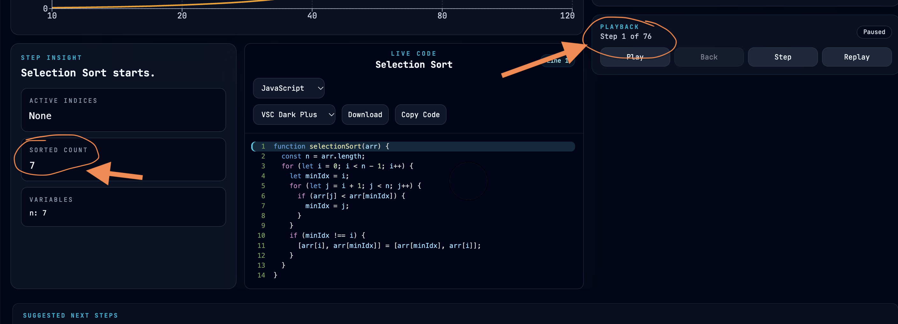
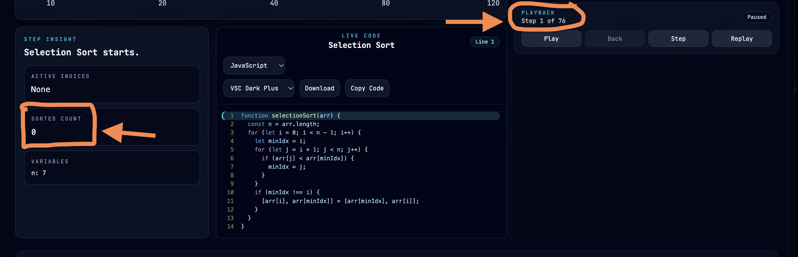

# R62-T047 — selectionSortSteps: executable documentation (evidence)

**Student:** Aadarsh Bhardwaj (2601010001)
**Issue:** https://github.com/s-and-ai-ru-2/AlgoScope/issues/2
**Branch:** `student/2601010001/R62-T047`
**Base commit:** `973f3e6` (same commit the issue is pinned to)
**Run on:** 2026-11-27

> This folder is coursework evidence only. Per the task, remove `work/R62-T047/`
> from any later upstream branch.

## 1. What was changed

| File                                           | Change                                                                                                   |
| ---------------------------------------------- | -------------------------------------------------------------------------------------------------------- |
| `src/algorithms/sorting/selectionSortSteps.js` | Added a JSDoc block with the worked `[3, 1, 2]` fixture; fixed 3 line-map entries and 1 replay-state bug |
| `src/algorithms/course/r62-t047.test.js`       | New focused Vitest regression (46 tests)                                                                 |

The existing implementation was reused. No new algorithm module was added, and
no other file was modified.

### Bugs found and fixed

All four were found by running the existing code against the fixtures before
any change was made.

| #   | Where                         | Before     | After                     | Effect before the fix                                                                                            |
| --- | ----------------------------- | ---------- | ------------------------- | ---------------------------------------------------------------------------------------------------------------- |
| 1   | `javascript.lineMap.complete` | `15`       | `14`                      | The JS source has 14 lines, so the "complete" highlight pointed at a line that does not exist                    |
| 2   | `cpp.lineMap.swap`            | `10`       | `11`                      | The swap highlight landed on `if (minIdx != i) {` instead of `swap(arr[i], arr[minIdx]);`                        |
| 3   | `go.lineMap.swap`             | `10`       | `11`                      | The swap highlight landed on `if minIdx != i {` instead of the swap line                                         |
| 4   | `start` step, `sortedIndices` | live array | copy `[...sortedIndices]` | The first frame was later mutated to `[0, 1, …, n-1]`, so the UI showed every bar as sorted before sorting began |

Bug 4 detail: `createStep` does not copy `sortedIndices`. Every other step
already passed a copy; only the `start` step passed the live array that the
generator later `push`es into. `Visualizer.jsx:299` colours a bar "sorted"
when its index is in `sortedIndices`, and `Visualizer.jsx:447` displays the
count.

### Contract (as documented in the source)

- Pure step generator: it copies its input and never mutates the caller's array.
- Ascending only; the source defines no descending option.
- `[]` and `[1]` are valid and return their input unchanged. These are the
  smallest supported collections; no minimum size was found in the UI code.
- A `swap` frame shows the array before the swap, with `indices` naming the
  two positions; the next frame shows the result.
- The generator loops `i < n` while the displayed sources use `n - 1`. The last
  element gets a no-comparison pass, and the sorted result is identical.

## 2. Inputs: expected vs. actual

| Input                         | Expected    | Actual      | Swaps | Frames | Result |
| ----------------------------- | ----------- | ----------- | ----- | ------ | ------ |
| `[3, 1, 2]`                   | `[1, 2, 3]` | `[1, 2, 3]` | 2     | 21     | ✅     |
| `[2, 2, 1]`                   | `[1, 2, 2]` | `[1, 2, 2]` | 1     | 19     | ✅     |
| `[1, 2, 3]` (already ordered) | `[1, 2, 3]` | `[1, 2, 3]` | 0     | 17     | ✅     |
| `[3, 2, 1]` (reversed)        | `[1, 2, 3]` | `[1, 2, 3]` | 1     | 20     | ✅     |
| `[1]`                         | `[1]`       | `[1]`       | 0     | 5      | ✅     |
| `[]`                          | `[]`        | `[]`        | 0     | 2      | ✅     |

Trace of `[3, 1, 2]` (swap indices and the frame after each swap):

```
pass 0: swap [0,1]  -> [1, 3, 2]   sortedIndices [0]
pass 1: swap [1,2]  -> [1, 2, 3]   sortedIndices [0, 1]
pass 2: no swap     -> [1, 2, 3]   sortedIndices [0, 1, 2]
```

## 3. Required automated check

```
npm test -- src/algorithms/course/r62-t047.test.js && npm run build && npm run lint
```

| Step                    | Result                                       |
| ----------------------- | -------------------------------------------- |
| Focused test            | ✅ **46 passed (46)**                        |
| `npm run build`         | ✅ 4434 modules transformed                  |
| `npm run lint`          | ✅ exit 0 (`--max-warnings 0`)               |
| Full suite (`npm test`) | ✅ 4 files, 81 passed (35 existing + 46 new) |

Test groups:

- **Pure results (7):** the six fixtures above, plus a check that the input is not mutated.
- **Replay steps for `[3, 1, 2]` (4):** frame count, swap positions, `sortedIndices` growth, independent snapshots.
- **Swap counts (5):** the other fixtures.
- **Source and line maps (30):** for each of the 7 languages, line numbers are in range, every step `lineKey` is mapped, highlighted lines contain the expected code, and `complete` is the last line. Plus `resolveSelectionSortLine` behaviour.

## 4. The tests fail on an incorrect implementation

**A. Original file from `main` (before the fixes):** the tests exit non-zero.

```
× grows sortedIndices by one per pass, starting from none        (bug 4)
× javascript: every line number is inside the code               (bug 1)
× cpp: highlighted lines show the right code                     (bug 2)
× go: highlighted lines show the right code                      (bug 3)
× javascript: complete points at the last line                   (bug 1)
× resolveSelectionSortLine uses the language map with a JS fallback
Tests  6 failed | 40 passed (46)
```

**B. Temporary mutant of the comparison**, in the generator only (not the
displayed source strings):

```diff
-      if (arr[j] < arr[minIdx]) {
+      if (arr[j] > arr[minIdx]) {
```

```
Tests  9 failed | 37 passed (46)
```

All nine failures are sorting-result and swap-count tests. After the file was
restored, all 46 tests passed again, and the mutant was not committed.

To reproduce B:

```
F=src/algorithms/sorting/selectionSortSteps.js
cp $F /tmp/sel.bak
L=$(awk '/^export function generateSelectionSortSteps/{f=1} f && /if \(arr\[j\] < arr\[minIdx\]\)/{print NR; exit}' $F)
sed -i '' "${L}s/arr\[j\] < arr\[minIdx\]/arr[j] > arr[minIdx]/" $F
npm test -- src/algorithms/course/r62-t047.test.js   # expect 9 failures, non-zero exit
cp /tmp/sel.bak $F
```

(`sed -i ''` is the macOS form; on Linux use `sed -i`.)

## 5. Browser smoke check (bug 4 is visible in the UI)

Steps: run `npm run dev`, open `/sort?algo=selection`, choose **Step** mode,
click **Start Sort**, and stay on the first frame ("Selection Sort starts.",
Step 1 of 76). Both screenshots use the same 7-element input (`n: 7`). The
"before" shot was taken with this branch's changes stashed (`main` code).

|                  | Before (`main`)                                                  | After (this branch)                    |
| ---------------- | ---------------------------------------------------------------- | -------------------------------------- |
| Frame            | Step 1 of 76, "Selection Sort starts."                           | Step 1 of 76, "Selection Sort starts." |
| **Sorted Count** | **7**: every element is reported sorted before sorting begins ❌ | **0** ✅                               |

**Before:**



**After:**



## 6. Tool versions

| Tool    | Version              |
| ------- | -------------------- |
| Node.js | v20.20.2             |
| npm     | 10.8.2               |
| Vitest  | 4.1.7                |
| Vite    | 7.1.11               |
| ESLint  | 9.38.0               |
| OS      | macOS 27.2.1 (arm64) |

Dependencies were installed from `package-lock.json` with `npm install`.
